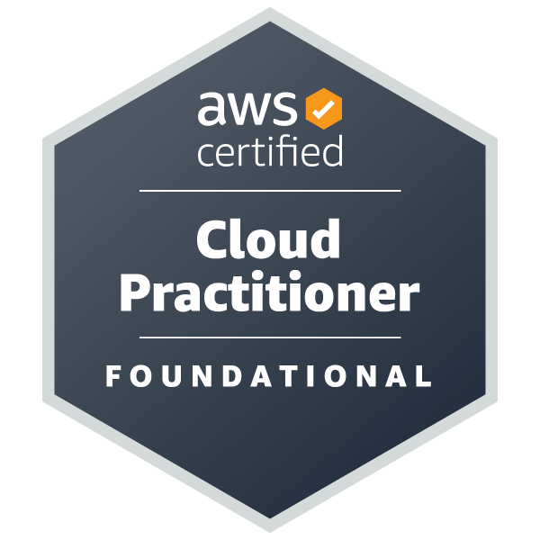
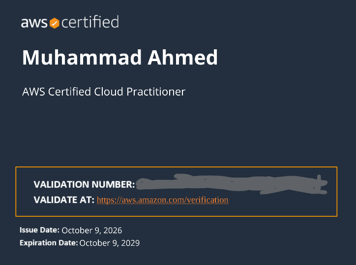

# AWS Certification Journey

Documenting my AWS certification path in public: what I studied, what I built in the console, and the architecture behind it.

## Certifications

| Certification | Status | Preparation |
|---|---|---|
| AWS Certified Cloud Practitioner (CLF-C02) | Passed | 7 days |
| AWS Certified Solutions Architect - Associate (SAA-C03) | In progress | Exam planned: early November 2026 |

## Cloud Practitioner (CLF-C02)

Passed after a 7-day focused sprint.

- Verify badge: [Credly](YOUR_CREDLY_BADGE_LINK)
- Certificate: see below
- Detailed CLF notes: [CLF repository](YOUR_CLF_REPO_LINK)

## Solutions Architect Associate (SAA-C03)

**Approach**

- Scenario-based learning in the style of Tutorials Dojo
- Focus on edge cases and cost vs. performance trade-offs
- Hands-on work in the AWS Console; every lab is cleaned up afterwards to avoid cost

**Where to find progress**

- Daily notes and architecture explanations: [`docs/`](docs/)
- Hands-on labs with steps and screenshots: [`labs/`](labs/)
- Architecture diagrams: [`diagrams/`](diagrams/)

## Repository Layout

| Folder | Contents |
|---|---|
| `docs/` | One document per study day |
| `labs/` | Hands-on lab walkthroughs |
| `diagrams/` | Architecture diagrams |
| `assets/` | Badge and certificate images |

## Contributing

Found a mistake or a better explanation? Open an issue or a pull request. Corrections are welcome.

## License

MIT
