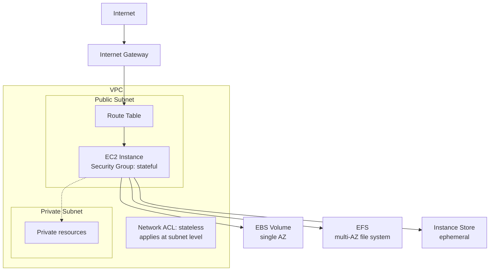

# Day 1: Core Foundations, Networking and Storage

## Goal
Understand the building blocks every architecture depends on: identity, compute, network, and storage. 
## Architecture

## What I studied

### IAM and Security
- Principle of least privilege
- IAM roles vs. policies
- Multi-factor authentication (MFA)

### EC2 and Compute
- Purchasing options: On-Demand, Reserved, Spot
- Security Groups (stateful) vs. Network ACLs (stateless)

### VPC and Networking
- Public vs. private subnets
- Route tables and Internet Gateway (IGW)
- Elastic Network Interfaces (ENI) and Elastic IPs

### Placement Groups
| Type | Use case |
|---|---|
| Cluster | Low latency and high throughput inside one AZ |
| Spread | Instances on distinct hardware for fault isolation |
| Partition | Large distributed workloads (Hadoop, Cassandra) |

### Storage
| Service | Key points |
|---|---|
| EBS | Block storage, tied to one AZ. Types: gp3, io2, st1, sc1. Snapshots. Encryption with KMS |
| EFS | Regional NFSv4 file system, POSIX permissions, usable across multiple AZs |
| Instance Store | Ephemeral NVMe storage, very high IOPS, data is lost on stop or terminate |

## Hands-on
Fill in what you actually did, for example:
- Created an IAM user with MFA and a least-privilege policy
- Launched an EC2 instance in a public subnet
- Created and attached an EBS volume, took a snapshot

## Key takeaways
- Security Groups are stateful; NACLs are stateless.
- EBS lives in one AZ; EFS is regional.
- Instance Store is fast but not durable.

## Exam angle
- "Shared file system across AZs" points to EFS.
- "Highest IOPS, data can be lost" points to Instance Store.
- "Isolate single instances from hardware failure" points to a Spread placement group.
