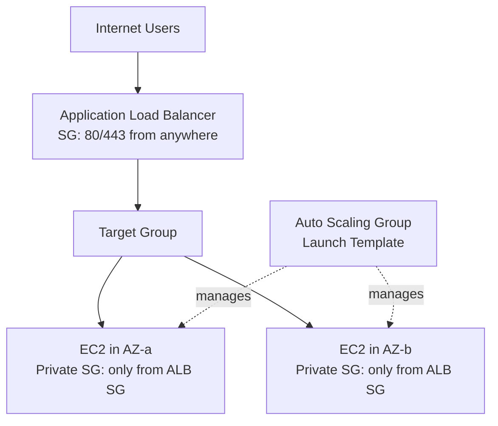

# Day 2: High Availability, Load Balancing and Auto Scaling

## Goal
Design an application that stays available when an instance or an AZ fails, and scales with demand.

## Architecture

## What I studied

### Load Balancers
| Type | Layer | Use case |
|---|---|---|
| ALB | 7 | HTTP/HTTPS, path and host routing, WAF, SNI for multiple certificates |
| NLB | 4 | TCP/UDP, ultra-low latency, millions of requests per second, static IP |
| GWLB | 3 | Route traffic through third-party firewall and inspection appliances |

### Advanced features
- **Sticky sessions:** duration-based cookies keep a user on the same instance so session data is not lost.
- **Connection draining (deregistration delay):** in-flight requests get time to finish during scale-in or maintenance, which avoids 504 errors.
- **Auto Scaling Group:** launch templates, target tracking on `RequestCountPerTarget`, lifecycle hooks for graceful termination.
- **Security hardening:** backend instances accept traffic only from the ALB security group ID, not from the internet.

## Hands-on lab
Steps performed in the AWS Console:

1. Created a Target Group (empty at first)
2. Deployed an internet-facing ALB across multiple AZ subnets
3. Created a Launch Template
4. Created an Auto Scaling Group using the template and attached it to the Target Group
5. Deleted all resources after the lab (ASG, ALB, Target Group, Launch Template)

Detailed steps: [labs/day-02-alb-asg](../labs/day-02-alb-asg/README.md)

## Key takeaways
- Always reference the ALB security group in the backend SG instead of opening IP ranges.
- Connection draining is the fix for errors during scale-in.
- Use ALB for HTTP routing and NLB when static IPs or extreme performance are needed.

## Exam angle
- "Route by URL path" points to ALB.
- "Static IP and TCP at very high throughput" points to NLB.
- "Inspect traffic with a third-party firewall" points to GWLB.
- "Users lose cart on scale-in" points to sticky sessions plus connection draining.
