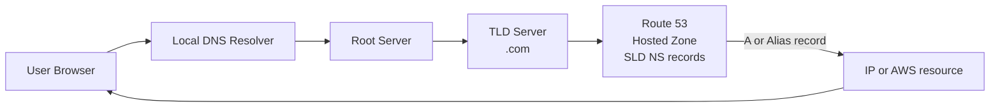
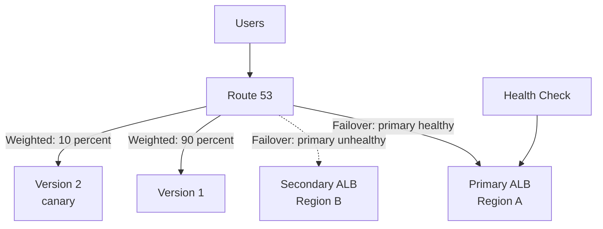
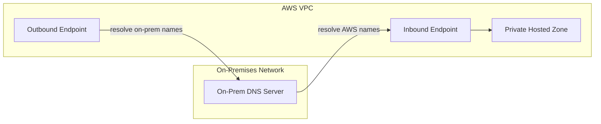

# Day 4: Amazon Route 53 and DNS

## Goal
Route users to the right endpoint using DNS: by weight, health, latency, location, or source IP.

## Architecture

### DNS resolution flow

### Failover and Weighted routing

### Hybrid DNS with Route 53 Resolver

## What I studied

### DNS Fundamentals
- Domain hierarchy: TLD, SLD, FQDN
- Resolution flow from resolver to root, TLD, and authoritative server
- DNS uses port 53
- Route 53 offers a 100% availability SLA

### Hosted Zones and Records
- **Public Hosted Zone:** answers queries from the internet.
- **Private Hosted Zone:** answers queries only inside associated VPCs.
- Record types: `A` (IPv4), `AAAA` (IPv6), `CNAME`, `Alias`.

| | CNAME | Alias |
|---|---|---|
| Zone apex (root domain) | Not allowed | Allowed |
| Target | Any hostname | AWS resources (ALB, CloudFront, S3 website, API Gateway) |
| Cost | Standard query charge | Free for queries to AWS resources |
| Health check | Separate | Native (Evaluate Target Health) |

- **High TTL:** fewer DNS queries and lower cost, but slow to propagate changes.
- **Low TTL:** fast changes (migrations, failover), but more queries.

### Routing Policies
| Policy | How it works | Use case |
|---|---|---|
| Simple | One record, one or more values, no health checks | Single resource |
| Weighted | Traffic split by percentage | Canary testing, gradual rollout |
| Failover | Active-passive with health check | Disaster recovery |
| Latency-based | Lowest network latency to the user | Global applications |
| Geolocation | By user country or continent | Localization, compliance, content restriction |
| Geoproximity | By distance, with bias (+/-) via Traffic Flow | Shift traffic between Regions |
| Multi-Value Answer | Up to 8 healthy records returned | Simple client-side load balancing with health filtering |
| IP-based | By client source IP CIDR range | Route specific ISPs or networks |

### Health Checks
- **Endpoint monitoring:** checks a public endpoint by HTTP, HTTPS, or TCP.
- **Calculated health check:** combines several checks with AND, OR, or NOT.
- **Private resources:** Route 53 health checkers cannot reach private subnets. Create a CloudWatch alarm on a metric and attach a health check to the alarm.

### Advanced and Hybrid Networking
- **Third-party domain:** buy the domain elsewhere, create a Route 53 hosted zone, and update the NS records at the registrar.
- **Route 53 Resolver Inbound endpoint:** on-premises to AWS.
- **Route 53 Resolver Outbound endpoint:** AWS to on-premises (with forwarding rules).

## Hands-on
Architecture review and Tutorials Dojo scenario drills. (Edit this line if you built anything in the console.)

Walkthrough: [labs/day-04-route53](../labs/day-04-route53/README.md)

## Key takeaways
- Use Alias, not CNAME, for the root domain pointing to an AWS resource.
- Weighted is for traffic splitting; Failover is for active-passive DR.
- Latency is based on network speed, Geolocation is based on user location. They are not the same.
- Health checks for private resources need a CloudWatch alarm.
- Domain registration and DNS hosting are separate; changing the registrar NS records delegates DNS.

## Exam angle
- "Root domain to ALB or CloudFront" points to Alias record.
- "Send 10 percent of traffic to a new version" points to Weighted.
- "Active-passive disaster recovery" points to Failover with health check.
- "Lowest latency for global users" points to Latency-based.
- "Serve content by user country" points to Geolocation.
- "Shift traffic toward a Region using a bias" points to Geoproximity.
- "Route by client CIDR range" points to IP-based routing.
- "On-premises must resolve AWS private names" points to Resolver Inbound endpoint.
- "AWS must resolve on-premises names" points to Resolver Outbound endpoint.
- "Health check for a resource in a private subnet" points to CloudWatch alarm health check.
