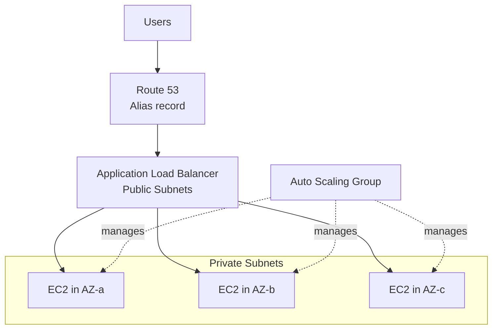
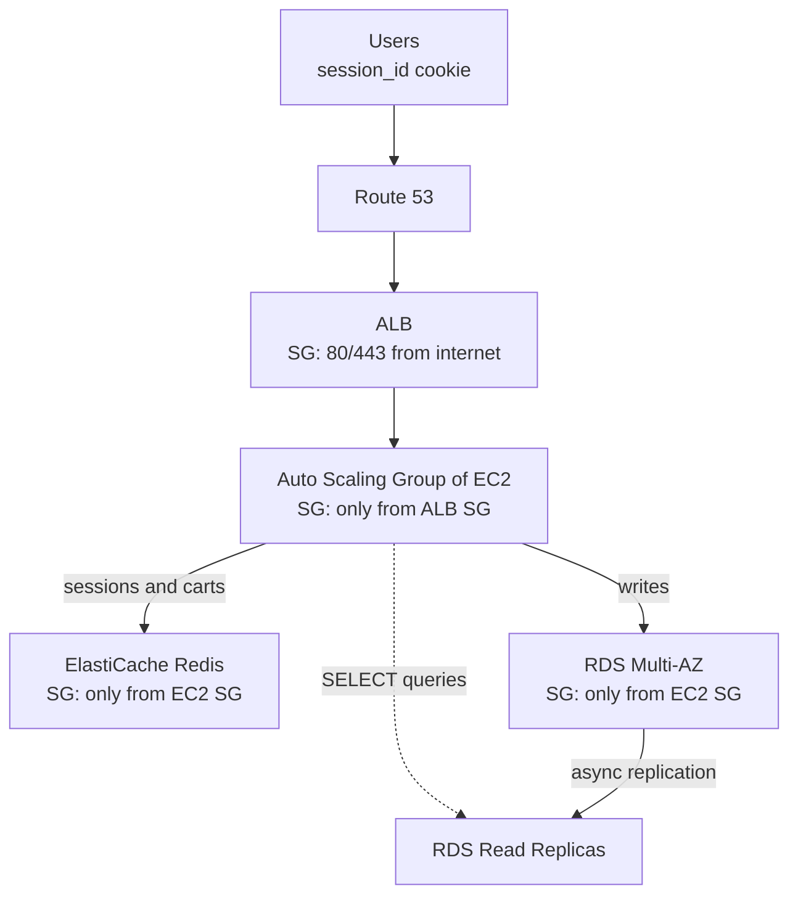
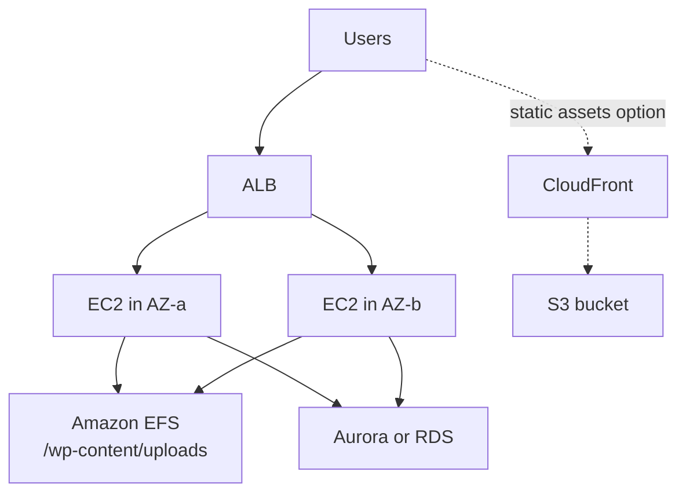
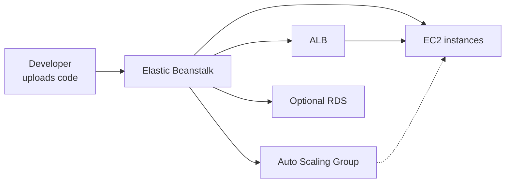

# Day 5: Classic Solutions Architecture and Design Patterns

## Goal
Learn how a simple application evolves into a scalable, highly available, and secure architecture, using four case studies.

## Architecture

### Case 1: Stateless web app (WhatIsTheTime.com)

### Case 2: Stateful e-commerce app (MyClothes.com)

### Case 3: CMS with shared files (MyWordPress.com)

### Case 4: Elastic Beanstalk

## What I studied

### Case Study 1: WhatIsTheTime.com (stateless)
- Started with a single server, then scaled horizontally.
- Production pattern: Route 53 Alias, ALB in public subnets, ASG of EC2 instances in private subnets across multiple AZs.
- Stateless means any instance can serve any request.

### Case Study 2: MyClothes.com (stateful)
- Problem: shopping carts stored in local EC2 memory are lost when a request hits another instance.
- Fix: move sessions to ElastiCache for Redis. The browser sends a `session_id` cookie, and any instance looks up the session in Redis.
- Database: RDS Multi-AZ for availability, Read Replicas to offload SELECT queries.
- Security: chained Security Groups.

| Layer | Allows inbound from |
|---|---|
| ALB | Internet (80/443) |
| EC2 | ALB security group |
| RDS and Redis | EC2 security group |

### Case Study 3: MyWordPress.com (CMS)
- Problem: uploads saved to local `/wp-content/uploads` exist on one instance only.
- Fix: mount Amazon EFS on all instances as a shared POSIX file system.
- Alternative for static assets: S3 with CloudFront.

| Option | Good for |
|---|---|
| EFS | Shared file system, POSIX access, multi-AZ |
| S3 and CloudFront | Static assets, global delivery, lower cost |

### Case Study 4: Elastic Beanstalk
- Platform as a Service for developers.
- Upload code (Node.js, PHP, Python, and others); Beanstalk provisions and manages EC2, ALB, and ASG.
- You still own and can access the underlying resources, but you do not have to build them.

## Hands-on
Architecture review and Tutorials Dojo scenario drills. (Edit this line if you built anything in the console.)

Walkthrough: [labs/day-05-classic-architectures](../labs/day-05-classic-architectures/README.md)

## Key takeaways
- Stateless design is the foundation of horizontal scaling.
- Store sessions externally (Redis), not on the instance.
- Use EFS for shared files across instances, S3 for static assets.
- Chain security groups by referencing other security groups, not IP ranges.
- Elastic Beanstalk trades control for speed of deployment.

## Exam angle
- "User loses shopping cart when scaling" points to external session store (ElastiCache or DynamoDB).
- "Multiple instances need the same uploaded files" points to EFS.
- "Static content, global users, low cost" points to S3 with CloudFront.
- "Deploy code without managing infrastructure" points to Elastic Beanstalk.
- "Backend only reachable from the load balancer" points to a security group referencing the ALB security group.
