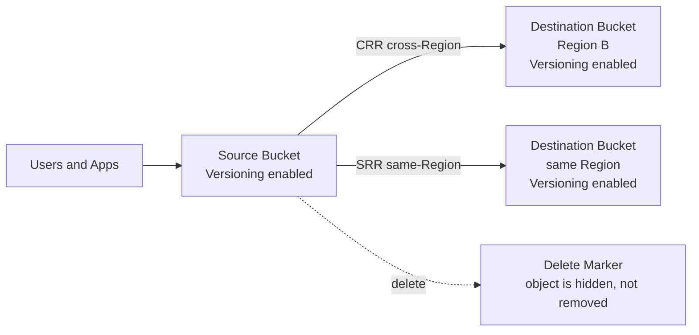
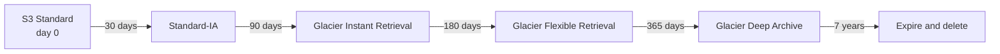
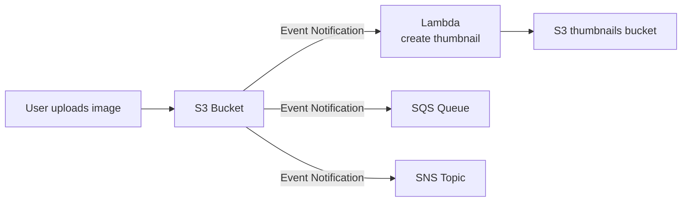
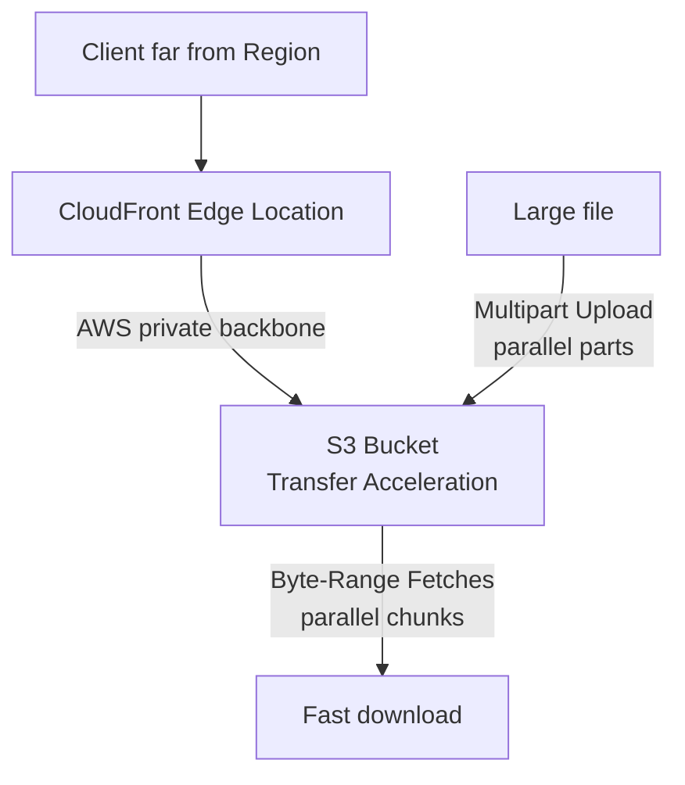

# Day 6: Amazon S3 Fundamentals and Advanced Management

## Goal
Store, secure, replicate, tier, and manage objects in S3 at scale, and choose the right storage class and performance feature.

## Architecture

### Versioning and Replication

### Storage class lifecycle

### Event-driven processing

### Performance features

## What I studied

### Part 1: S3 Core

- Object storage with globally unique bucket names. Buckets are created in a Region.
- Maximum object size is 5 TB. Multipart Upload is recommended above 100 MB and mandatory above 5 GB.

#### Security
| Control | Scope |
|---|---|
| IAM Policy | Attached to a user, group, or role (who can do what) |
| Bucket Policy | Attached to the bucket (resource-based, supports cross-account access) |
| Block Public Access | Account or bucket level safety switch that overrides public policies |

#### Static Website Hosting
- Served over an HTTP endpoint.
- HTTPS requires CloudFront in front of the bucket.

#### Versioning and Replication
- Versioning can be suspended but never fully disabled.
- Deleting a versioned object adds a **Delete Marker**; older versions remain and can be restored.
- Replication (CRR cross-Region, SRR same-Region) requires **Versioning enabled on both source and destination buckets**.
- Only new objects are replicated after the rule is created (existing objects need Batch Replication).

### Part 2: Storage Classes
| Class | Use case |
|---|---|
| S3 Standard | Frequently accessed, daily active data |
| S3 Standard-IA | Infrequent access, instant retrieval, multi-AZ |
| S3 One Zone-IA | Infrequent access, non-critical or re-creatable data, single AZ |
| S3 Glacier Instant Retrieval | Archive with millisecond access |
| S3 Glacier Flexible Retrieval | Archive, retrieval in minutes to hours |
| S3 Glacier Deep Archive | Cheapest, long-term retention and compliance, retrieval in hours |
| S3 Intelligent-Tiering | Unknown or unpredictable access, no retrieval fees, small monitoring fee |
| S3 Express One Zone | Single-digit millisecond latency for HPC and ML, single AZ |

### Part 3: Advanced Management
- **Lifecycle Rules:** transition objects to cheaper classes by age, or expire (delete) them automatically.
- **S3 Analytics:** analyzes access patterns to recommend when to move data from Standard to Standard-IA. Reports start after 24 to 48 hours and need about 30 days of data to be useful.
- **Requester Pays:** the requester pays for the request and data transfer out instead of the bucket owner. Requester must be authenticated.
- **Event Notifications:** send events (create, delete, restore) to SNS, SQS, or Lambda. Example: automatic thumbnail generation.
- **Performance:**
  - Multipart Upload: parallel upload of parts for large files.
  - Transfer Acceleration: uploads go to the nearest edge location, then over the AWS private backbone.
  - Byte-Range Fetches: parallel downloads of specific byte ranges, also useful to fetch only part of a file.
- **Batch Operations:** run one job (encrypt, change ACLs, restore, copy) across millions or billions of objects, usually driven by an S3 Inventory report.
- **Storage Lens:** central dashboard for usage, cost trends, and security posture across accounts and Regions.

| Storage Lens tier | Metrics |
|---|---|
| Free | Bucket-level summary metrics |
| Advanced | Prefix-level metrics, activity metrics, longer history |

## Hands-on
Architecture review and Tutorials Dojo scenario drills. (Edit this line if you built anything in the console.)

Walkthrough: [labs/day-06-s3](../labs/day-06-s3/README.md)

## Key takeaways
- Versioning protects against accidental deletes; both buckets need it for replication.
- Pick the storage class by access pattern: unknown pattern means Intelligent-Tiering, long-term compliance means Deep Archive.
- Lifecycle rules automate cost savings; S3 Analytics only advises on Standard to Standard-IA.
- Transfer Acceleration is for global uploads; Multipart and Byte-Range are for large file speed.
- Storage Lens Advanced is the answer for prefix-level, organization-wide visibility.

## Exam angle
- "HTTPS for a static website on S3" points to CloudFront.
- "Replication fails to start" points to Versioning not enabled on one of the buckets.
- "Unknown access pattern, no operational overhead" points to Intelligent-Tiering.
- "Cheapest multi-year regulatory archive" points to Glacier Deep Archive.
- "Non-critical, re-creatable, infrequent access" points to One Zone-IA.
- "Move objects to cheaper tiers after 30 days" points to Lifecycle Rule.
- "Recommend when to move data to Standard-IA" points to S3 Analytics.
- "Downloader pays the transfer cost" points to Requester Pays.
- "Run code when a file is uploaded" points to Event Notifications with Lambda.
- "Fast uploads from users around the world" points to Transfer Acceleration.
- "Apply an operation to millions of existing objects" points to Batch Operations with S3 Inventory.
- "Organization-wide visibility at prefix level" points to Storage Lens Advanced Metrics.
