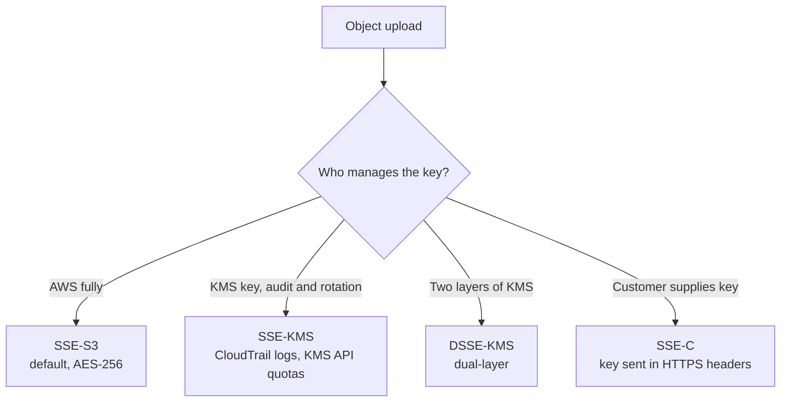
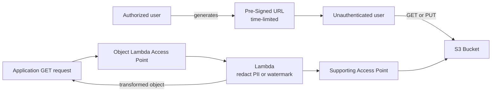
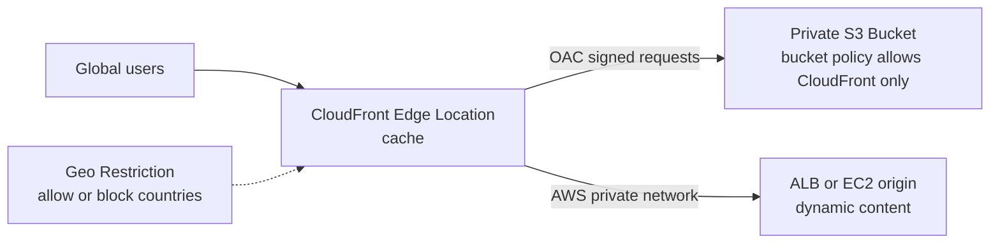
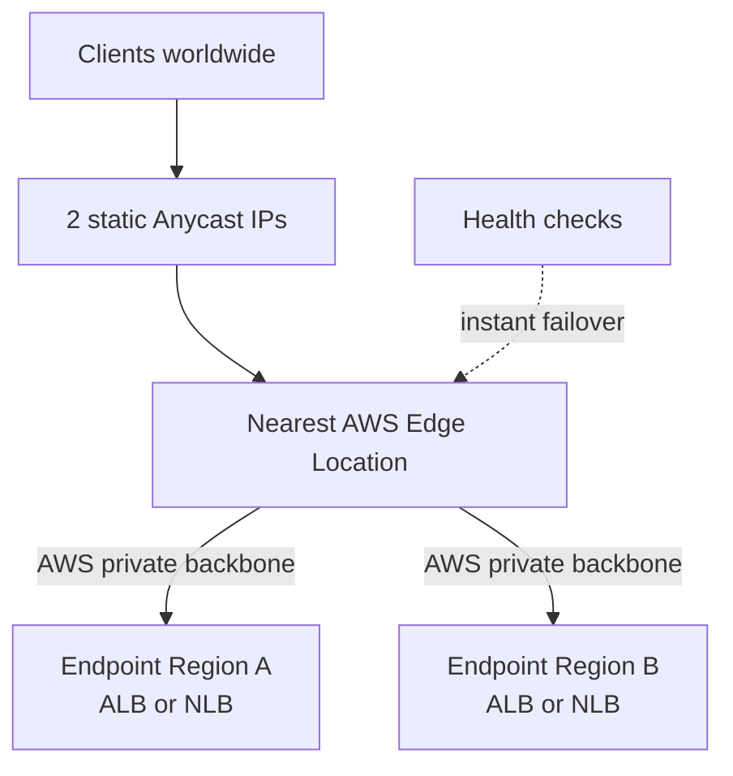

# Day 7: S3 Security, CloudFront and Global Accelerator

## Goal
Protect data in S3 with encryption and immutability, share it safely, and deliver content globally with the right network service.

## Architecture

### S3 encryption options

### Pre-Signed URL and Object Lambda

### CloudFront with private S3 origin

### Global Accelerator

## What I studied

### Section 14: S3 Security

#### Server-Side Encryption
| Type | Key managed by | Key points |
|---|---|---|
| SSE-S3 | AWS | Default for new objects, AES-256 |
| SSE-KMS | AWS KMS | CloudTrail audit trail, key rotation control. Each request calls the KMS API, so quotas can throttle high traffic |
| DSSE-KMS | AWS KMS | Two layers of encryption, for strict government or defense rules |
| SSE-C | Customer | Key is sent in HTTP headers on every request. HTTPS is mandatory. CLI or API only |

#### CORS
- Lets a web page loaded from **Origin A** fetch assets from S3 at **Origin B**.
- Configured on the bucket that holds the assets (Origin B) and allows specific origins and methods.

#### MFA Delete and Access Logs
- **MFA Delete** requires Versioning, and protects permanent deletion of versions and disabling versioning.
- Only the **root account** can enable it, using the CLI.
- **Server Access Logs** record requests to a bucket. Store logs in a **different** bucket to avoid a logging loop.

#### Pre-Signed URLs
- Temporary, time-limited URL for upload (PUT) or download (GET).
- Gives access to a user who has no AWS credentials. The URL carries the permissions of the user who created it.

#### WORM (Write Once Read Many)
| Feature | Applies to | Behavior |
|---|---|---|
| Object Lock, Compliance mode | S3 objects | Nobody, including root, can delete or change during retention |
| Object Lock, Governance mode | S3 objects | Users with special permission can bypass retention |
| Legal Hold | S3 objects | Indefinite hold, independent of retention period. Can be removed with permission |
| Glacier Vault Lock | S3 Glacier vault | Lock a vault policy so it can never be changed |

- Object Lock requires Versioning.

#### Access Points and Object Lambda
- **Access Points:** each team or VPC gets its own endpoint with its own policy, instead of one huge bucket policy.
- **Object Lambda:** a Lambda function transforms the object during a `GET` request (redact PII, watermark, convert format). The stored object stays unchanged.

### Section 15: CloudFront and Global Accelerator

#### Amazon CloudFront
- CDN with edge locations worldwide for low-latency delivery of static and dynamic content.
- **S3 origin with OAC (Origin Access Control):** keep the bucket private and allow only CloudFront in the bucket policy.
- **ALB or EC2 origin:** CloudFront reaches the origin over the AWS network. The origin must be reachable by CloudFront.
- **Geo Restriction:** allowlist or blocklist by country.
- **Cache Invalidation:** purge stale objects by path (for example `/assets/*`) after updating content.

#### AWS Global Accelerator
- Gives **2 static Anycast IP addresses** as the fixed entry point.
- Routes traffic to the nearest edge location, then over the AWS private backbone to the endpoint.
- Works for TCP and UDP (gaming, VoIP, IoT) as well as HTTP.
- Endpoints: ALB, NLB, EC2, Elastic IP.
- **Fast failover** across Regions without waiting for DNS TTL.

#### CloudFront vs. Global Accelerator
| Feature | CloudFront | Global Accelerator |
|---|---|---|
| Purpose | CDN with caching | Network path optimization, no caching |
| Protocols | HTTP, HTTPS, WebSocket | TCP, UDP, HTTP, HTTPS |
| Best for | Images, video, web apps, API caching | Gaming, VoIP, IoT, non-HTTP, static IP requirement |
| Origin protection | OAC for S3 | Not applicable. Endpoints are ALB, NLB, EC2, Elastic IP |

## Hands-on
Architecture review and Tutorials Dojo scenario drills. (Edit this line if you built anything in the console.)

Walkthrough: [labs/day-07-s3-security-cdn](../labs/day-07-s3-security-cdn/README.md)

## Key takeaways
- SSE-S3 is the default; choose SSE-KMS when you need audit trails and key control, and watch KMS quotas.
- Pre-signed URLs share one object temporarily without creating IAM users.
- Compliance mode cannot be bypassed by anyone; Governance mode can.
- OAC keeps S3 private while still serving content through CloudFront.
- CloudFront caches content; Global Accelerator does not cache, it speeds up and stabilizes the network path.

## Exam angle
- "Audit who used the encryption key" points to SSE-KMS with CloudTrail.
- "Customer must hold the encryption key" points to SSE-C.
- "S3 throttled with many encrypted requests" points to KMS API quota limits.
- "Browser blocked a request to another origin" points to CORS.
- "Prevent permanent deletion without MFA" points to MFA Delete.
- "Give a customer temporary access to download a file" points to a Pre-Signed URL.
- "Nobody, even root, can delete for 7 years" points to Object Lock Compliance mode.
- "Admins can override retention if needed" points to Governance mode.
- "Hold data during an investigation with no end date" points to Legal Hold.
- "Different permissions for different teams on one bucket" points to Access Points.
- "Hide sensitive fields when an application reads an object" points to S3 Object Lambda.
- "Private S3 bucket, only reachable through CloudFront" points to OAC.
- "Block users from specific countries" points to CloudFront Geo Restriction.
- "Remove outdated cached files now" points to Cache Invalidation.
- "Gaming or VoIP with static IPs and fast regional failover" points to Global Accelerator.
