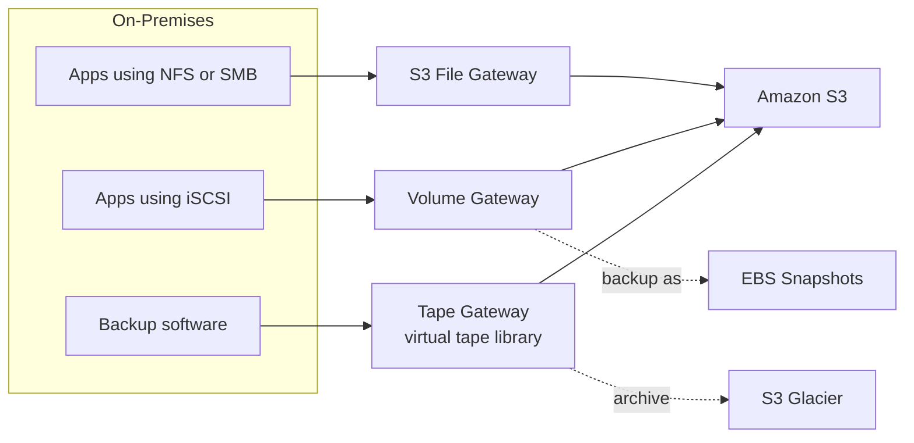
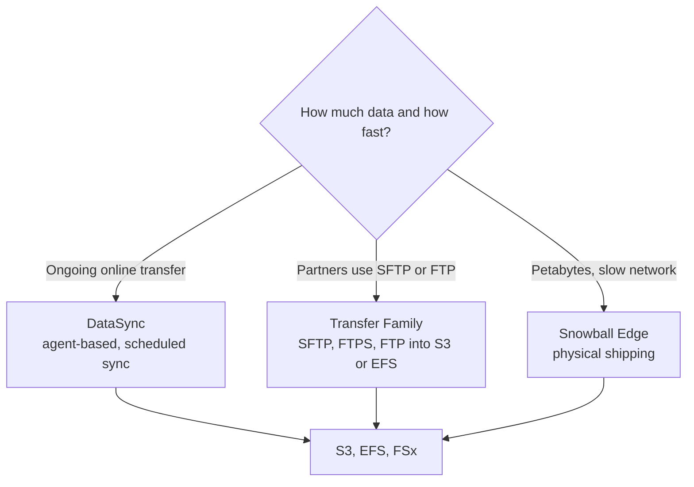
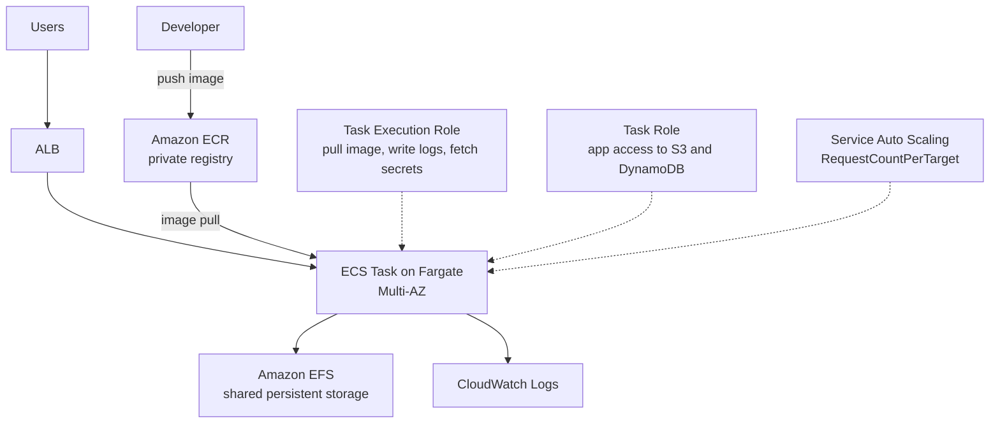

# Day 8: Storage Extras, Hybrid Cloud Migration and Containers

## Goal
Choose the right migration and hybrid storage service, and run containerized applications with ECR, ECS, Fargate, and EKS.

## Architecture

### Hybrid storage with Storage Gateway

### Data migration options

### ECS on Fargate with correct IAM roles

## What I studied

### Section 16: Storage Extras and Hybrid Cloud Migration

#### AWS Snowball Edge
- Physical device shipped to you for bulk data transfer.
- Use when data is in the terabytes to petabytes range and network bandwidth is too slow or limited.
- Data is loaded on site, the device is shipped back, and AWS imports it into S3.

#### Amazon FSx Family
| Service | Key points |
|---|---|
| FSx for Windows File Server | Native Windows file system, SMB protocol, Active Directory integration |
| FSx for Lustre | High-performance computing and machine learning, millions of IOPS, sub-millisecond latency, integrates with S3 |
| FSx for NetApp ONTAP | Migrate existing NetApp workloads, supports NFS, SMB, and iSCSI |
| FSx for OpenZFS | Migrate existing ZFS workloads to AWS |

#### AWS Storage Gateway
| Gateway | Protocol | Behavior |
|---|---|---|
| S3 File Gateway | NFS, SMB | Files stored as objects in S3, with local cache |
| Volume Gateway | iSCSI | Volumes backed by S3, backed up as EBS Snapshots |
| Tape Gateway | iSCSI VTL | Virtual tape library for backup software, archived to S3 and Glacier |

#### DataSync vs. Transfer Family
| | DataSync | Transfer Family |
|---|---|---|
| Purpose | High-speed network sync between on-premises and AWS, or between AWS services | Let partners use SFTP, FTPS, or FTP to reach S3 or EFS |
| How it works | Agent, scheduled or one-time tasks | Managed endpoint, no servers to run |
| Typical use | Migrations, recurring sync | Legacy file transfer workflows |

### Section 18: Containers on AWS

#### Amazon ECR
- Private Docker container image registry. Images are pulled by ECS and EKS.

#### Amazon ECS Launch Types
| | EC2 launch type | Fargate launch type |
|---|---|---|
| Servers | You manage and patch the EC2 instances | Serverless compute, no EC2 to manage |
| Capacity | You provision the cluster | You define CPU and memory per task |

#### The IAM trap: two different roles
| Role | Used by | Example permissions |
|---|---|---|
| Task Execution Role | The ECS agent | Pull images from ECR, write CloudWatch logs, fetch secrets at startup |
| Task Role | Your application code | Access S3, DynamoDB, and other AWS services |

#### Storage and Scaling
- **Fargate with EFS:** shared persistent storage across tasks and AZs (needs Fargate platform version 1.4.0 or higher).
- **Service Auto Scaling:** target tracking on the ALB `RequestCountPerTarget` metric.

#### Amazon EKS
- Managed Kubernetes on AWS.
- Choose it when you already use Kubernetes: existing Helm charts, `kubectl`, and custom manifests move over with little change.

## Hands-on
Architecture review and Tutorials Dojo scenario drills. (Edit this line if you built anything in the console.)

Walkthrough: [labs/day-08-hybrid-and-containers](../labs/day-08-hybrid-and-containers/README.md)

## Key takeaways
- Network too slow for the data size means Snowball Edge.
- DataSync moves data; Transfer Family gives partners SFTP or FTP access.
- Storage Gateway is the bridge between on-premises protocols and AWS storage.
- FSx is for specific file system needs; pick by protocol and workload.
- Task Execution Role is for ECS itself; Task Role is for your code.
- Fargate removes server management; EKS is for Kubernetes users.

## Exam angle
- "Petabytes of data and limited bandwidth" points to Snowball Edge.
- "Windows file shares with Active Directory" points to FSx for Windows File Server.
- "HPC or machine learning, millions of IOPS" points to FSx for Lustre.
- "Migrate NetApp or ZFS workloads" points to FSx for NetApp ONTAP or OpenZFS.
- "On-premises apps need NFS or SMB with S3 as the backend" points to S3 File Gateway.
- "On-premises block storage using iSCSI with cloud backup" points to Volume Gateway.
- "Replace physical tapes for backup" points to Tape Gateway.
- "Scheduled high-speed sync from on-premises to S3" points to DataSync.
- "Partners must keep using SFTP or FTP" points to Transfer Family.
- "Run containers with no servers to manage" points to ECS on Fargate.
- "Container cannot pull its image or write logs" points to the Task Execution Role.
- "Container cannot access S3 or DynamoDB" points to the Task Role.
- "Shared persistent storage for Fargate tasks across AZs" points to Amazon EFS.
- "Existing Kubernetes workloads and Helm charts" points to Amazon EKS.
