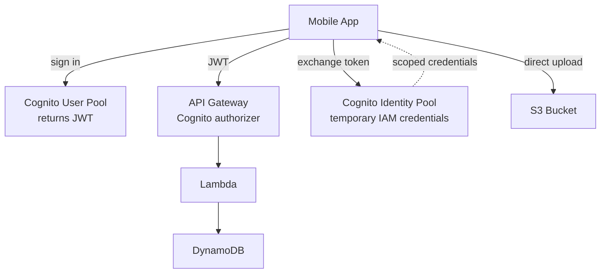
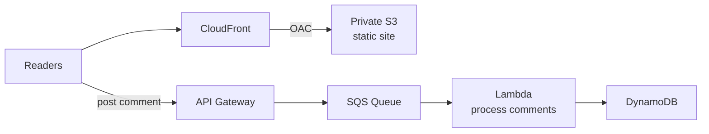
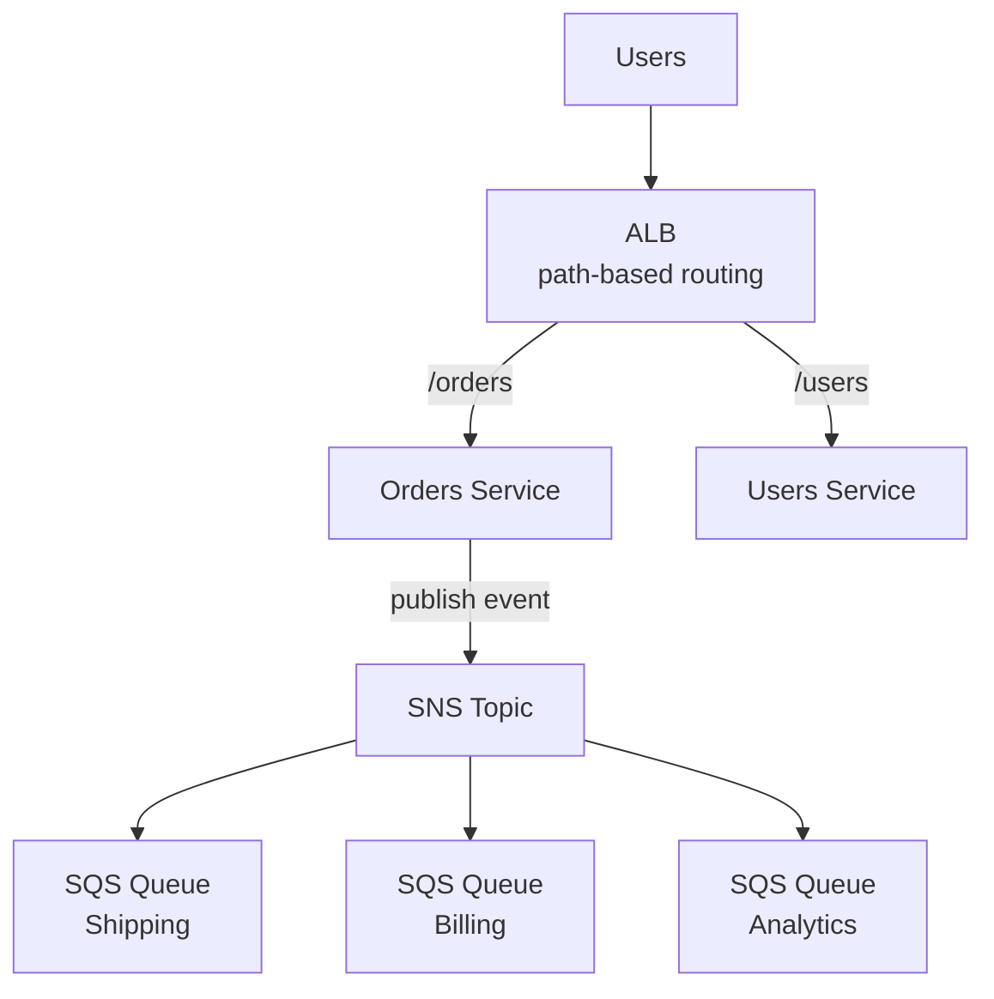
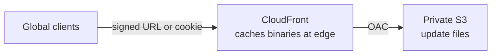
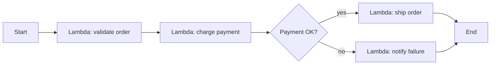

# Day 9: Serverless, Decoupling and Real-World Architectures

Covers 26 and 27 October 2026.

## Goal
Build applications without managing servers, decouple components with queues and topics, and recognize the standard serverless architecture patterns.

## Architecture

### Pattern 1: Mobile app (MyTodoList)

### Pattern 2: Static blog with decoupled comments (MyBlog.com)

### Pattern 3: Microservices with fan-out

### Pattern 4: Software updates distribution

### Step Functions workflow

## What I studied

### 26 October: Serverless Core Services

#### AWS Lambda
- Maximum timeout is 15 minutes.
- **Reserved concurrency:** guarantees capacity for a function and also caps it.
- **Provisioned concurrency:** pre-initialized environments that remove cold starts.
- **Cold start:** the delay when a new execution environment initializes.
- **Lambda in a VPC:** can reach private resources (RDS, ElastiCache). Internet access needs a NAT Gateway; AWS services can be reached with VPC endpoints.

| | CloudFront Functions | Lambda@Edge |
|---|---|---|
| Language | JavaScript | Node.js, Python |
| Speed | Sub-millisecond | Slower, up to seconds |
| Triggers | Viewer request and response | Viewer and origin request and response |
| Network and file access | No | Yes |
| Use case | URL rewrites, header changes, simple redirects | Heavier logic, auth, calls to other services |

#### Amazon Cognito
| | User Pools | Identity Pools |
|---|---|---|
| Purpose | Sign-up and sign-in (authentication) | Temporary AWS credentials (authorization) |
| Output | JWT tokens | Temporary IAM credentials |
| Example | Login to the app, API Gateway authorizer | Let a user upload directly to S3 |

#### Amazon DynamoDB
- **DAX:** in-memory cache in front of DynamoDB, microsecond read latency, no application rewrite beyond using the DAX client.
- **Global Tables:** multi-Region, active-active replication.
- **DynamoDB Streams:** ordered stream of item changes, can trigger Lambda.

#### API Gateway and Step Functions
- **API Gateway:** managed front door for REST, HTTP, and WebSocket APIs. Supports authorizers, throttling, rate limiting, and caching.
- **Step Functions:** visual state machines that orchestrate multi-step workflows across Lambda and other services, with retries and error handling.

### 27 October: Deep Revision and Real-World Architectures

#### Revision blocks (20 complex scenarios)
| Block | Topics |
|---|---|
| IAM, EC2, VPC | NACL vs Security Group, Multi-AZ NAT Gateway |
| High Availability and Databases | ALB, NLB, ASG, RDS Multi-AZ vs Read Replicas, Aurora, ElastiCache |
| Storage | S3 classes, Object Lock Compliance mode, EBS types, EFS |
| Hybrid and Storage Extras | Tape Gateway, Snowball Edge, FSx for Lustre, Transfer Family |
| Containers and Decoupling | ECS Task Role vs Task Execution Role, SQS Visibility Timeout, SNS and SQS fan-out, Amazon MQ |

#### Decoupling services
- **SQS:** pull-based queue. Visibility Timeout hides a message while a consumer processes it (default 30 seconds, maximum 12 hours).
- **SNS:** push-based pub/sub topic.
- **SNS and SQS fan-out:** one event published once, delivered to many queues that process independently.
- **Amazon MQ:** managed ActiveMQ or RabbitMQ for migrating applications that use standard protocols (JMS, AMQP, MQTT). Use SQS and SNS for new cloud-native designs.

#### Section 19: Architecture patterns
| Pattern | Services | Key idea |
|---|---|---|
| Mobile app | Cognito, S3, API Gateway, DynamoDB | User Pool for login, Identity Pool for direct S3 access |
| Static website | CloudFront, OAC, S3, SQS | Private bucket behind CDN, comments queued to avoid overload |
| Microservices | ALB path routing, SNS, SQS | Route by path, fan-out events to independent consumers |
| Software updates | CloudFront, OAC or Signed URLs | Cache large binaries at the edge to cut latency and egress cost |

## Hands-on
Architecture review and Tutorials Dojo scenario drills. 3 complex scenarios solved with 100% accuracy on 26 October, plus 20 scenarios in the 27 October revision. (Edit this line if you built anything in the console.)

Walkthrough: [labs/day-09-serverless-architectures](../labs/day-09-serverless-architectures/README.md)

## Key takeaways
- Lambda scales automatically, but remember the 15-minute limit and cold starts.
- Provisioned concurrency fixes cold starts; reserved concurrency guarantees and caps capacity.
- User Pool means "who are you"; Identity Pool means "here are AWS credentials".
- Queues and topics decouple components so one slow part does not break the rest.
- Keep S3 private and serve through CloudFront with OAC.

## Exam angle
- "Lambda job runs longer than 15 minutes" points to ECS, Fargate, or Step Functions.
- "Remove Lambda cold starts" points to Provisioned Concurrency.
- "Lambda needs internet while in a VPC" points to a NAT Gateway.
- "Simple URL rewrite or header change at the edge, lowest cost" points to CloudFront Functions.
- "Heavier logic or origin-level processing at the edge" points to Lambda@Edge.
- "User sign-in with tokens" points to Cognito User Pools.
- "Mobile users upload directly to S3 with temporary credentials" points to Cognito Identity Pools.
- "Microsecond reads for DynamoDB with minimal code change" points to DAX.
- "Multi-Region active-active DynamoDB" points to Global Tables.
- "React to item changes in DynamoDB" points to DynamoDB Streams.
- "Throttle or rate limit public API calls" points to API Gateway.
- "Coordinate several Lambda functions with retries and branching" points to Step Functions.
- "Messages reprocessed while a consumer is still working" points to increasing the SQS Visibility Timeout.
- "One event delivered to several independent consumers" points to SNS and SQS fan-out.
- "Migrate an existing app using JMS, AMQP, or MQTT" points to Amazon MQ.
- "Route /orders and /users to different services" points to ALB path-based routing.
- "Distribute large software files globally at low egress cost" points to CloudFront with Signed URLs or OAC.
