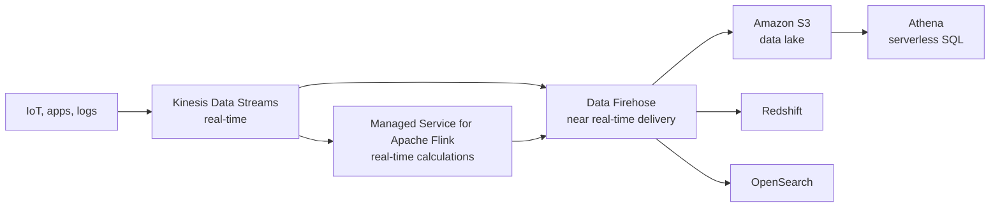
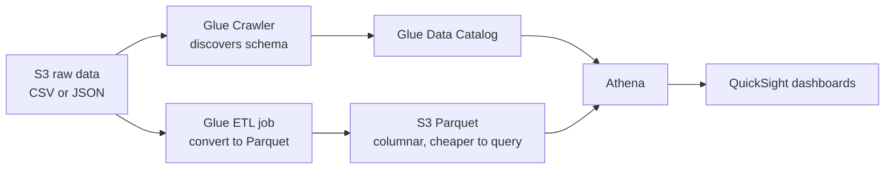
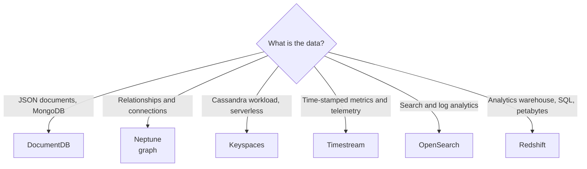

# Day 10: Specialized Databases, Analytics and Machine Learning Services

## Goal
Pick the right purpose-built database, build an analytics pipeline on S3, and map each machine learning service to its exam trigger.

## Architecture

### Analytics pipeline: ingest, transform, query

### Glue: discover and convert data

### Choosing a specialized database

## What I studied

### Specialized Databases
| Service | What it is | Exam trigger |
|---|---|---|
| DocumentDB | Fully managed, MongoDB-compatible JSON document store | "Migrate MongoDB" |
| Neptune | Graph database (Gremlin, SPARQL) | "Social network, fraud detection, relationships" |
| Keyspaces | Serverless, Apache Cassandra-compatible (CQL) | "Cassandra, no servers to manage" |
| Timestream | Serverless time-series database | "IoT telemetry, server metrics over time" |

### Analytics and Big Data
- **Athena:** serverless SQL directly on data in S3, pay per data scanned. Using Parquet (columnar) and partitioning reduces cost and speeds up queries.
- **AWS Glue:**
  - Crawlers discover the schema and populate the Glue Data Catalog.
  - ETL jobs transform data, for example CSV or JSON to Parquet.
- **OpenSearch:** real-time log indexing, free-text search, and dashboards through OpenSearch Dashboards (the Kibana equivalent).
- **Redshift:** columnar data warehouse for OLAP, SQL analytics at petabyte scale. Redshift Spectrum queries data in S3 without loading it.

#### Ingestion pipeline
| Service | Role | Latency |
|---|---|---|
| Kinesis Data Streams | Ingest and store streaming data, custom consumers | Real-time |
| Managed Service for Apache Flink (formerly Kinesis Data Analytics) | Real-time stream calculations | Real-time |
| Data Firehose | Load streams into S3, Redshift, OpenSearch, with no consumer code | Near real-time (buffered) |

### Machine Learning Services
| Service | What it does | Exam trigger |
|---|---|---|
| Textract | OCR for text, tables, and forms in scanned documents and invoices | "Extract data from scanned PDFs" |
| Kendra | Enterprise search with natural language questions | "Search company documents by asking questions" |
| Polly | Text to speech (MP3) | "Convert text to spoken audio" |
| Rekognition | Image and video analysis: objects, faces, moderation | "Detect faces or inappropriate content" |
| Transcribe | Speech to text | "Convert call recordings to text" |
| Comprehend | NLP: sentiment, entities, language, PII detection | "Find sentiment or PII in text" |
| SageMaker | Build, train, and deploy your own ML models | "Custom ML model" |

## Hands-on
Architecture review and Tutorials Dojo scenario drills. (Edit this line if you built anything in the console.)

Walkthrough: [labs/day-10-analytics-and-ml](../labs/day-10-analytics-and-ml/README.md)

## Key takeaways
- Match the database to the data shape: documents, graph, wide-column, or time series.
- Athena plus Glue plus S3 is the serverless analytics stack. Parquet lowers cost.
- Streams are real-time; Firehose is near real-time and needs no consumer code.
- Redshift is for warehousing and OLAP, not for transactional workloads.
- For ML questions, the service name usually matches the verb: extract, search, speak, detect, transcribe, analyze.

## Exam angle
- "Migrate an existing MongoDB application" points to DocumentDB.
- "Highly connected data, find relationships" points to Neptune.
- "Cassandra workload without managing servers" points to Keyspaces.
- "IoT sensor data indexed by time" points to Timestream.
- "Run SQL on S3 without loading data" points to Athena.
- "Reduce Athena cost" points to Parquet and partitioning.
- "Discover schema automatically" points to a Glue Crawler.
- "Convert CSV to Parquet" points to a Glue ETL job.
- "Free-text search or log analytics with dashboards" points to OpenSearch.
- "Petabyte-scale data warehouse" points to Redshift.
- "Real-time calculations on a stream" points to Managed Service for Apache Flink.
- "Deliver streaming data to S3 or Redshift with no code" points to Data Firehose.
- "Extract text and tables from invoices" points to Textract.
- "Employees ask natural language questions over internal documents" points to Kendra.
- "Turn text into speech" points to Polly.
- "Detect faces, objects, or unsafe images" points to Rekognition.
- "Convert audio to text" points to Transcribe.
- "Sentiment or PII in text" points to Comprehend.
- "Build and train a custom model" points to SageMaker.
