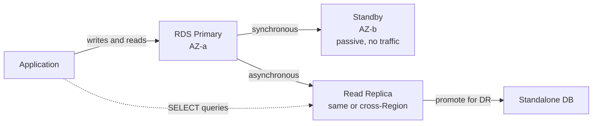
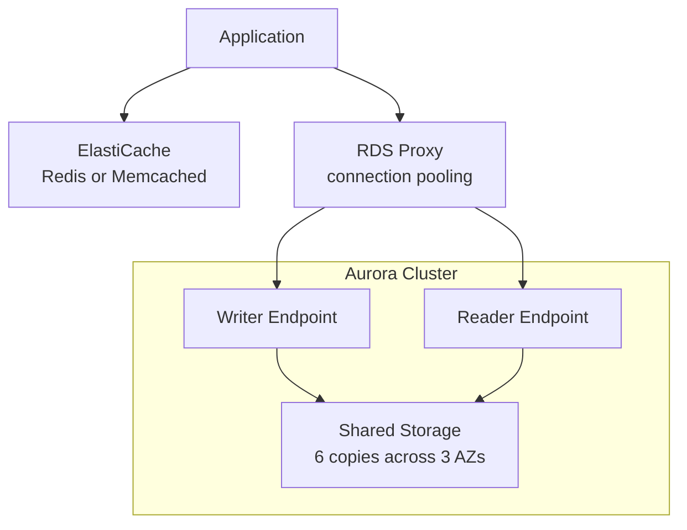

# Day 3: RDS, Aurora and ElastiCache

## Goal
Choose the right database and caching strategy for availability, read scaling, and performance.

## Architecture

### RDS: Multi-AZ vs. Read Replicas

### Aurora with RDS Proxy and ElastiCache

## What I studied

### RDS Core
| Feature | Multi-AZ | Read Replica |
|---|---|---|
| Replication | Synchronous | Asynchronous |
| Purpose | High availability | Read scaling, DR |
| Traffic | Standby is passive | Serves SELECT queries |
| Failover | Automatic DNS failover | Manual promotion |
| Cross-Region | No | Yes |

### Enterprise and Backup
- **RDS Custom:** OS and root access for legacy or customized applications.
- **Backups and PITR:** automated backups plus transaction logs allow restore to any point in time within the retention window.

### Aurora
- Decoupled compute and shared storage: 6 copies across 3 AZs.
- Writer endpoint for writes, Reader endpoint for load-balanced reads.
- Aurora Serverless v2: capacity scales automatically with load.
- Global Database: cross-Region replication for low-latency reads and disaster recovery.

### ElastiCache
| | Redis | Memcached |
|---|---|---|
| Persistence and replication | Yes | No |
| Data structures | Rich (sorted sets, etc.) | Simple key-value |
| Multi-AZ failover | Yes | No |
| Multi-threaded | No | Yes |

- **Session store:** keep user sessions in the cache so any instance can serve any user.
- **Leaderboards:** Redis Sorted Sets give real-time ranking.
- **Lazy Loading:** cache on read miss. Only requested data is cached, but data can go stale.
- **Write-Through:** update the cache on every write. Data stays fresh, but unused data is cached too.

## Hands-on
Architecture review and Tutorials Dojo scenario drills. (Edit this line if you built anything in the console.)

## Key takeaways
- Multi-AZ is for availability; Read Replicas are for performance.
- Aurora storage is shared and replicated 6 ways, so replicas do not need their own copy.
- RDS Proxy fixes connection exhaustion, for example from many Lambda functions or instances.
- Choose Redis when you need persistence, replication, or data structures; Memcached for simple multi-threaded caching.

## Exam angle
- "Automatic failover with no code change" points to Multi-AZ.
- "Offload reporting or SELECT queries" points to a Read Replica.
- "Cross-Region disaster recovery for Aurora" points to Aurora Global Database.
- "Too many database connections" points to RDS Proxy.
- "Real-time leaderboard" points to Redis Sorted Sets.
- "OS-level access on a managed database" points to RDS Custom.

## Drill result
Tutorials Dojo mixed scenarios: 5/5, including the RDS Proxy connection exhaustion case.
